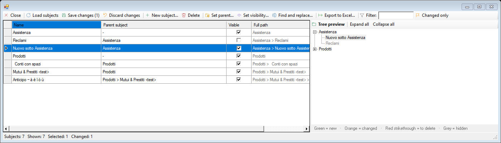

# Subject Manager for XrmToolBox


**Subject Manager** is an [XrmToolBox](https://www.xrmtoolbox.com) tool for the bulk management of
Dynamics 365 / Dataverse **subjects** (the `subject` table used to categorise cases, articles and products).

Load the whole subject tree into a grid, change many subjects at once, check the result in a live tree
preview, and save everything in one go.

Author: **Emilio Torella**



## Features

| Area | What you can do |
|---|---|
| Load | Load every subject of the connected environment (with paging), sorted by hierarchy path. |
| Edit in the grid | Change **Name**, **Parent subject** (combo with the full path, `-` = root) and **Visible** (checkbox). |
| Create | **New subject…** creates a subject under the selected one (or any parent you choose). New subjects can be parents of other new subjects before saving. |
| Delete | **Delete** (or the Del key) marks the selected subjects *and all their sub-subjects* for deletion. **Restore** cancels the mark. Nothing is deleted until you save. |
| Bulk actions | On the selected rows: **Set parent…**, **Set visibility…**, **Find and replace…** in the name. |
| Tree preview | A tree on the right shows the hierarchy as it will look in the CRM after saving, rebuilt on every change and kept in sync with the grid. |
| Export | **Export to Excel…** writes an `.xlsx` in tree order (Name, Parent, Full path, Level, Visible, Feature mask, Status, IDs). |
| Safety | Circular references are blocked, changed cells are highlighted, *Changed only* filter, **Discard changes** reverts everything, confirmation before saving (deletions are called out explicitly). |

### Colours

- **Green** – new subject (not saved yet)
- **Orange / yellow** – changed subject
- **Red strikethrough** – marked for deletion
- **Grey** – hidden subject (not visible)

### Visibility

The **Visible** checkbox maps the `featuremask` column: checked = non-zero, unchecked = `0`.
When a subject is made visible again its original non-zero value is restored (or `1`).

### How saving works

Changes are sent with `ExecuteMultipleRequest` in batches of 100, in this order:

1. **Creates**, from the top of the tree down (a new parent is created before its children).
   New subjects get their ID on the client, so other subjects can already point to them.
2. **Updates** (only the changed columns are sent).
3. **Deletes**, from the bottom of the tree up (children before their parent).

Operations that fail because they depend on another one are retried in further passes while progress is made.
Remaining errors are listed and their rows stay highlighted. A subject linked to records (for example cases)
may be refused by the CRM when you delete it: the error is shown and the row stays marked.

## Requirements

- XrmToolBox (built against XrmToolBoxPackage 1.2025.10.74, .NET Framework 4.8)
- Dynamics 365 / Dataverse user with read, create, write and delete privileges on *Subject*

## Install

**From the Tool Library** (once published): open XrmToolBox › *Tool Library*, search for *Subject Manager*, install.

**Manually**: copy `SubjectManager.dll` to `%APPDATA%\MscrmTools\XrmToolBox\Plugins` and restart XrmToolBox.

> XrmToolBox caches the tool list (name, description, logo) in `Plugins\manifest.json` and refreshes a tool
> only when its **version** changes. Always increase `<Version>` in `SubjectManager.csproj` before installing
> a new build, otherwise the old description and logo keep showing.

## Build

```
dotnet build -c Release
```

Output: `bin\Release\net48\SubjectManager.dll` (a single DLL, no extra dependencies).
`dotnet build -c Release -p:DeployPlugin=true` also copies it to the XrmToolBox Plugins folder.

The icons are generated by `tools\GenerateIcons.ps1` (writes `Images\icon32.png`, `Images\icon80.png`
and `PluginImages.cs`, used by the XrmToolBox tool list).

## Publish to NuGet / XrmToolBox Tool Library

The package is described by [`SubjectManager.nuspec`](SubjectManager.nuspec).

1. Increase `<Version>` in `SubjectManager.csproj` (format `1.YYYY.M.N`; the package version is taken from it,
   so assembly and package always match) and update `<releaseNotes>` in the `.nuspec`.
2. Build the package:
   ```
   dotnet pack -c Release
   ```
   It is written to `nupkg\`. The DLL goes to `lib\net48\Plugins` as XrmToolBox requires.
3. Push it to nuget.org (API key from your nuget.org account):
   ```
   dotnet nuget push nupkg\<package>.nupkg --api-key <key> --source https://api.nuget.org/v3/index.json
   ```
4. When the package is indexed on nuget.org, register it at <https://www.xrmtoolbox.com/plugins/new/>.
   The XrmToolBox team reviews and validates new tools before they appear in the Tool Library.

## Project structure

| File | Content |
|---|---|
| `SubjectManagerPlugin.cs` | XrmToolBox plugin entry point and metadata (name, description, logo) |
| `SubjectManagerControl.cs` | Main UI: toolbar, grid, load, edit, bulk actions, save |
| `SubjectManagerControl.Tree.cs` | Tree preview |
| `SubjectManagerControl.Delete.cs` | Delete / restore |
| `SubjectManagerControl.Export.cs` | Export to Excel |
| `XlsxWriter.cs` | Minimal `.xlsx` writer (no external libraries) |
| `SubjectRow.cs` | Grid row model (original vs current values, status) |
| `Dialogs.cs` | Pop-up dialogs |
| `ToolbarIcons.cs` | Toolbar icons drawn from the Windows icon font |
| `PluginImages.cs` | Generated base64 logos |

## License

[MIT](LICENSE) © 2026 Emilio Torella
